<p align="center">
  
</p>

<p align="center">
  <a href="https://github.com/ishandutta2007/Awesome-Awesome-Awesome"></a>
  <a href="https://discord.gg/jc4xtF58Ve"></a>
  <a href="https://github.com/ishandutta2007/Awesome-Microservice-Orchestration/stargazers"></a>
  <a href="https://github.com/ishandutta2007/Awesome-Microservice-Orchestration/network/members"></a>
  <a href="https://github.com/ishandutta2007/Awesome-Microservice-Orchestration/blob/main/LICENSE"></a>
  <a href="https://github.com/ishandutta2007/Awesome-Microservice-Orchestration/pulls"></a>
  <a href="https://github.com/ishandutta2007"></a>
</p>

---

# 🚀 Awesome Microservice Orchestration

> **A curated directory of SaaS platforms, open-source workflow engines, durable execution runtimes, and distributed state machines designed for polyglot microservice architectures.**

Microservice orchestration tools coordinate multi-step business transactions and long-running distributed processes across heterogeneous services. By centralizing execution flow, state persistence, automatic retries, exponential backoffs, compensation transactions (**Saga Pattern**), and deterministic replay, these platforms eliminate distributed limbo states where crashes or timeouts leave services inconsistent.

Whether you are implementing distributed transaction compensation, scheduling high-throughput batch jobs, coordinating human-in-the-loop approvals, or orchestrating multi-agent LLM reasoning workflows, this guide aggregates the industry's premier tools, market insights, and architectural trade-offs.

---

## 📑 Table of Contents

- [📊 Sector Overview & Market Dynamics](#-sector-overview--market-dynamics)
- [🏢 SaaS & Hosted Platforms](#-saas--hosted-platforms)
- [💻 Leading Open-Source Orchestration Engines](#-leading-open-source-orchestration-engines)
- [🧩 Key Architectural Patterns & Trade-offs](#-key-architectural-patterns--trade-offs)
- [🤝 How to Contribute](#-how-to-contribute)
- [💖 Support & Community](#-support--community)
- [📈 Star History](#-star-history)
- [⚠️ Disclaimer](#️-disclaimer)

---

## 📊 Sector Overview & Market Dynamics

The global cloud workflow and microservices orchestration sector is currently estimated at **$3.6 Billion in 2024–2025** and is projected to surpass **$11.8 Billion by 2030**, advancing at a compound annual growth rate (**CAGR of ~21.8%**). This accelerating expansion is propelled by distributed cloud-native adoptions, enterprise migrations from monolithic choreographies to durable execution runtimes, and the surging requirement for deterministic AI-agent pipelines.

The sector exhibits **moderate concentration at the foundational public cloud infrastructure layer**—where hyperscalers like Microsoft Azure, Google Cloud, and AWS capture baseline serverless workloads—yet remains **highly fragmented and aggressively competitive in the developer-first durable execution and polyglot framework segment**. In this developer layer, specialized innovators (e.g., Temporal, Orkes Conductor, Inngest, Trigger.dev, and Dapr) prevent single-vendor capture by competing on deterministic code-as-workflow authoring, millisecond task dispatch latencies, granular state replay, and vendor-neutral self-hosting freedoms.

---

## 🏢 SaaS & Hosted Platforms

The following table summarizes the leading hosted microservice orchestration services, sorted by **Company Size (Market Capitalization / Valuation) in descending order**:

| 🏷️ Platform / Service | 🏛️ Company Size (Valuation / Revenue) | 💳 Starting Tier Pricing | 🎁 Free Tier / Trial Limit | ⚙️ Architecture & Key Capabilities |
| :--- | :--- | :--- | :--- | :--- |
| **[Azure Logic Apps](https://azure.microsoft.com/en-us/products/logic-apps/)** | **~$3.1 Trillion** *(Microsoft Corp.)* | **$0.000025 per action execution** ($0.025 / 1,000 actions on Consumption); Standard dedicated (WS1) starts at **~$0.107/vCPU-hour** (~$78/month) | **4,000 built-in action executions/month free** forever; plus 30-day trial with **$200 Azure credits** | Enterprise visual low-code integration platform with 400+ pre-built SaaS connectors, automated B2B/EDI workflows, and hybrid connectivity to on-premise systems via on-prem data gateways. |
| **[Google Cloud Workflows](https://cloud.google.com/workflows)** | **~$2.1 Trillion** *(Alphabet Inc.)* | **$0.01 per 1,000 internal steps** executed (Charge Tier 1); **$0.02 per 1,000 external HTTP calls** | **5,000 internal steps & 2,000 external HTTP requests/month free** forever; plus **$300 credit for 90 days** for new GCP accounts | Serverless, highly scalable workflow engine defined in YAML/JSON. Deep native IAM-authenticated orchestration across Cloud Run, Cloud Functions, BigQuery, and external HTTP REST endpoints. |
| **[AWS Step Functions](https://aws.amazon.com/step-functions/)** | **~$2.1 Trillion** *(Amazon.com Inc.)* | **$0.025 per 1,000 state transitions** ($0.000025/transition for Standard); Express Workflows at **$1.00 per 1M requests** + **$0.00001667/GB-s** | **4,000 state transitions/month free forever** on the AWS Free Tier; no expiration | Fully managed visual serverless state machines using Amazon States Language (ASL). Native deep integrations with 220+ AWS services (Lambda, ECS, SQS, DynamoDB, SageMaker) with built-in audit trails. |
| **[Temporal Cloud](https://temporal.io/cloud)** | **$1.5 Billion** *(Temporal Technologies)* | **Pay-as-you-go starting at $0/month base** ($42 per 1M Actions + $0.042/GB-month Active Storage); Essentials tier starts at **$100/month** | **$150 in free consumption credits** (valid for 90 days) on signup; 30-day fully functional namespace trial | Managed control plane for Temporal's durable execution engine. Replaces self-hosted Cassandra/PostgreSQL cluster operations with SLA-backed 99.99% availability, automated failover, and observability. |
| **[Camunda 8 SaaS](https://camunda.com/)** | **~$1.0 Billion** *(Camunda Services GmbH)* | **Enterprise SaaS starting at ~$50,000/year** (custom-scoped based on high-volume process instance blocks and enterprise support tiers) | **30-day free trial** with 2 active clusters and full SaaS execution; free local developer cluster forever | Cloud-native, Zeebe-powered workflow and decision automation suite. Offers visual BPMN 2.0 / DMN modeling (Modeler), real-time process monitoring (Operate), and human task assignment (Tasklist). |
| **[Orkes Cloud](https://orkes.io/)** | **~$150 Million** *(Orkes Inc.)* | **Developer Cloud starting at $49/month** (or metered at $0.50 per 1,000 workflow executions); custom private offers via AWS/GCP Marketplaces | **Free Developer Sandbox tier forever** (shared cluster for prototyping); plus **14-day dedicated trial** (up to 100,000 task executions) | Enterprise managed version of Netflix Conductor OSS. Features horizontal auto-scaling, fine-grained RBAC, secret management, visual debugging, webhooks, and 14+ native GenAI/LLM orchestration task types. |
| **[Inngest Cloud](https://www.inngest.com/)** | **~$40 Million** *(Inngest Inc.)* | **Pro plan starting at $99/month** (includes 1,000,000 step executions/month; $0.00005 per extra execution) | **Free forever plan with 50,000 step executions/month**, 5 concurrent steps, and 24-hour trace history | Serverless event-driven durable function execution platform. Provides zero-infrastructure step functions, automated fan-outs, debouncing, and rate-limiting tailored for TypeScript, Node.js, and Python. |
| **[Trigger.dev Cloud](https://trigger.dev/)** | **~$15 Million** *(Trigger.dev / Y Combinator)* | **Hobby tier starting at $10/month** (includes $10 monthly usage credit); Pro tier starts at **$50/month** ($50 credit + 200 concurrency) | **Free forever plan with $5/month included usage credits**, 20 concurrent runs, 5 team members, and 1-day log retention | Developer-first background jobs and durable execution engine built specifically for TypeScript and Node.js. Handles long-running multi-hour workflows without serverless timeout constraints. |

---

## 💻 Leading Open-Source Orchestration Engines

Curated list of production-grade open-source workflow orchestrators and durable execution frameworks, **sorted in descending order by GitHub star count**:

### 1. 🌟 **[Apache Airflow](https://github.com/apache/airflow)** [](https://github.com/apache/airflow/stargazers)
* **License:** Apache 2.0 | **Primary Language:** Python
* **Description:** The undisputed industry-standard batch workflow orchestrator with the largest open-source data and compute ecosystem (3,000+ contributors, 20M+ monthly downloads). Workflows are authored strictly as Python Directed Acyclic Graphs (DAGs).
* **Key Strengths:** Expansive library of official provider packages for compute engines (Kubernetes, AWS, GCP, Azure, Databricks, Snowflake, Apache Spark). Features dynamic DAG generation, deferrable operators for async waiting without consuming worker slots, and mature enterprise scheduling.
* **Architecture & Trade-offs:** Optimized for scheduled data batch jobs and compute pipelining rather than millisecond-latency interactive microservice transactions or deterministic event-history replay.

---

### 2. ⚡ **[Conductor](https://github.com/conductor-oss/conductor)** [](https://github.com/conductor-oss/conductor/stargazers)
* **License:** Apache 2.0 | **Primary Language:** Java
* **Description:** The high-throughput, event-driven microservices orchestrator created and battle-tested at Netflix to coordinate billions of microservice transactions at internet scale.
* **Key Strengths:** Polling worker architecture allows polyglot workers (Java, Go, Python, C#, Node.js) to consume tasks without enforcing determinism inside worker business logic. Retains complete indefinite execution audit histories with instantaneous replay, step restart, and sub-workflow composition. Native integrations for AI agents, prompt chaining, MCP tool calls, and vector databases.
* **Architecture & Trade-offs:** Requires JDK 21+ for the modern mainline. Uses JSON workflow DSL definitions rather than code-as-workflow or BPMN modeling.

---

### 3. 🎯 **[Kestra](https://github.com/kestra-io/kestra)** [](https://github.com/kestra-io/kestra/stargazers)
* **License:** Apache 2.0 | **Primary Language:** Java
* **Description:** A modern, event-driven declarative orchestration platform designed for both business logic microservices and data engineering workflows.
* **Key Strengths:** Declarative YAML-based flow definitions with an integrated visual topology designer, real-time code editor, and live execution tracing. Offers 600+ pre-built plugins across databases, cloud providers, APIs, and AI runtimes. Scales linearly via a distributed Kafka or PostgreSQL queue architecture.
* **Architecture & Trade-offs:** Ideal for teams that want low-barrier declarative orchestration without having to program state machines imperatively in SDK code.

---

### 4. 🌐 **[Dapr](https://github.com/dapr/dapr)** [](https://github.com/dapr/dapr/stargazers)
* **License:** Apache 2.0 | **Primary Language:** Go
* **Description:** The CNCF Distributed Application Runtime providing portable, event-driven building blocks—including first-class **Dapr Workflow** for durable microservice orchestration.
* **Key Strengths:** Sidecar architectural pattern abstracts state management, service discovery, pub/sub messaging, secret management, and durable execution behind standard HTTP/gRPC APIs. Dapr Workflow allows writing durable orchestrations and activities directly in Python, JavaScript, .NET, Go, and Java.
* **Architecture & Trade-offs:** Extremely versatile across Kubernetes microservice meshes; adds sidecar proxy overhead but eliminates proprietary database and broker SDK lock-in.

---

### 5. 🔮 **[Prefect](https://github.com/PrefectHQ/prefect)** [](https://github.com/PrefectHQ/prefect/stargazers)
* **License:** Apache 2.0 | **Primary Language:** Python
* **Description:** A modern code-first workflow coordination engine that turns ordinary Python functions into resilient, observable distributed workflows using simple `@flow` and `@task` decorators.
* **Key Strengths:** Native dynamic execution (no static DAG compilation required), automatic parameter validation via Pydantic, seamless asynchronous execution with `asyncio`, intelligent retries, caching, and a clean web UI.
* **Architecture & Trade-offs:** Highly ergonomic for Python developers; focuses heavily on data pipelines and Python service coordination rather than polyglot multi-language microservice workers.

---

### 6. ⏱️ **[Temporal](https://github.com/temporalio/temporal)** [](https://github.com/temporalio/temporal/stargazers)
* **License:** MIT | **Primary Language:** Go (Server) / Polyglot SDKs
* **Description:** The industry's flagship code-first durable execution platform. Workflows are authored in standard application code (Go, Java, TypeScript, Python, .NET, PHP) using standard loops, conditionals, and functions.
* **Key Strengths:** **Deterministic Event Replay:** Workflow state is recorded as an immutable append-only Event History. If a worker process crashes, a replacement worker replays the event history to rehydrate local stack frames and local variables seamlessly. Polyglot Activities handle external network I/O with zero determinism constraints.
* **Architecture & Trade-offs:** Demands strict determinism inside Workflow definitions—modifying workflow logic or adding asynchronous steps to in-flight executions requires rigorous Workflow Versioning and `Continue-As-New` history bounding to avoid non-determinism exceptions.

---

### 7. ⚙️ **[Windmill](https://github.com/windmill-labs/windmill)** [](https://github.com/windmill-labs/windmill/stargazers)
* **License:** AGPL 3.0 / Apache 2.0 client | **Primary Language:** Rust
* **Description:** Extremely fast, developer-centric workflow engine, script runner, and internal app builder. Built from the ground up in Rust for sub-millisecond execution overhead.
* **Key Strengths:** Turns scripts written in Python, TypeScript, Go, Bash, SQL, and Rust into distributed workflows and microservice endpoints with auto-generated UIs. Features instant worker execution, dependency sandboxing, approval steps, and distributed worker auto-scaling.
* **Architecture & Trade-offs:** Superb for high-performance internal microservice orchestration, devops automations, and operational workflows; uses a unified Postgres-backed architecture.

---

### 8. 🚢 **[Argo Workflows](https://github.com/argoproj/argo-workflows)** [](https://github.com/argoproj/argo-workflows/stargazers)
* **License:** Apache 2.0 | **Primary Language:** Go
* **Description:** Container-native workflow engine implemented as a Kubernetes Custom Resource Definition (CRD), orchestrating complex step-based and DAG tasks directly as Kubernetes Pods.
* **Key Strengths:** Native integration with the Kubernetes resource model, RBAC, and storage classes. Exceptional parallel container scheduling, artifact passing (S3/GCS), and native support for compute-heavy ML pipelines and distributed CI/CD.
* **Architecture & Trade-offs:** Kubernetes-bound—every step spins up or runs within a container/pod. Best suited for containerized jobs and infrastructure tasks rather than low-latency RPC-style microservice transaction coordination.

---

### 9. 🎯 **[Trigger.dev](https://github.com/triggerdotdev/trigger.dev)** [](https://github.com/triggerdotdev/trigger.dev/stargazers)
* **License:** Apache 2.0 | **Primary Language:** TypeScript
* **Description:** Open-source TypeScript-first durable background job and workflow engine. Designed specifically to overcome serverless execution timeouts and manage long-running microservice tasks.
* **Key Strengths:** Deep integration with full-stack frameworks (Next.js, Remix, Astro). Zero configuration needed for long sleeps, step checkpoints, resume-from-failure, and real-time execution streaming to the browser.
* **Architecture & Trade-offs:** Focused primarily on the JavaScript and TypeScript ecosystem; provides a frictionless developer experience for web-tier and AI backend microservices.

---

### 10. 🗄️ **[Dagster](https://github.com/dagster-io/dagster)** [](https://github.com/dagster-io/dagster/stargazers)
* **License:** Apache 2.0 | **Primary Language:** Python
* **Description:** An asset-centric orchestration platform designed to coordinate and monitor distributed data and microservice operations by tracking state changes in the data assets they produce.
* **Key Strengths:** Software-Defined Assets (SDAs) model enables declarative dependency tracking, built-in testability without infrastructure, integrated lineage graphing, and partition-based incremental reprocessing.
* **Architecture & Trade-offs:** Built for organizations treating data pipelines and microservice states as assets; distinct paradigm from purely transactional or event-driven step engines.

---

### 11. 🛡️ **[Cadence](https://github.com/cadence-workflow/cadence)** [](https://github.com/cadence-workflow/cadence/stargazers)
* **License:** Apache 2.0 | **Primary Language:** Go / Java
* **Description:** The pioneering distributed, scalable durable execution engine developed by Uber Technologies to orchestrate millions of concurrent business workflows across Uber's global services.
* **Key Strengths:** Historical foundation and direct predecessor of Temporal. Battle-tested under immense real-world multi-datacenter ride-sharing throughput with multi-cluster replication, Cassandra/MySQL/PostgreSQL backends, and mature Go/Java client SDKs.
* **Architecture & Trade-offs:** Mature and battle-hardened; maintained actively by Uber and the open-source community, though newer developer-experience features and language SDKs are frequently pioneered in the Temporal ecosystem.

---

### 12. ⚡ **[Hatchet](https://github.com/hatchet-dev/hatchet)** [](https://github.com/hatchet-dev/hatchet/stargazers)
* **License:** Apache 2.0 | **Primary Language:** Go (Engine) / TypeScript & Python SDKs
* **Description:** A distributed, low-latency task queue and workflow engine engineered to handle high-concurrency background microservice execution, DAG orchestration, and transactional retries.
* **Key Strengths:** Replaces conventional Redis/Celery queue bottlenecks with a robust PostgreSQL and Go event engine capable of high task dispatch throughput. Provides real-time event streaming, cancellation tokens, step timeouts, and concurrency rate limits.
* **Architecture & Trade-offs:** Bridges the gap between lightweight asynchronous task queues and complex durable execution platforms; ideal for web backends and AI-agent workflows.

---

### 13. 🔄 **[Inngest](https://github.com/inngest/inngest)** [](https://github.com/inngest/inngest/stargazers)
* **License:** Apache 2.0 | **Primary Language:** Go
* **Description:** An event-driven workflow and durable execution runtime for building multi-step workflows, background tasks, and event-driven architectures without orchestrating external queue infrastructure.
* **Key Strengths:** SDKs for TypeScript, Python, and Go allow step functions (`step.run`, `step.sleep`, `step.waitForEvent`) to be embedded within standard HTTP APIs. Supports cross-service event triggering, deduplication windows, and automatic step retries with zero worker daemon management.
* **Architecture & Trade-offs:** Extremely developer-friendly for serverless environments; avoids maintaining persistent worker polling loops by dispatching steps via HTTP webhooks.

---

### 14. 📋 **[Camunda 8 (Zeebe)](https://github.com/camunda/camunda)** [](https://github.com/camunda/camunda/stargazers)
* **License:** Modified Apache 2.0 (Camunda License since 8.6 for self-managed production) | **Primary Language:** Java
* **Description:** A horizontally scalable, distributed workflow engine powered by the Zeebe append-only partitioned log with Raft consensus.
* **Key Strengths:** Native BPMN 2.0 execution enables business analysts and developers to collaborate on visual process diagrams. Polyglot external Job Workers communicate via gRPC/REST. Built for massive horizontal scaling, backpressure control, and high fault tolerance.
* **Architecture & Trade-offs:** Production self-hosting requires commercial licensing for enterprise features since version 8.6. Migration from Camunda 7 requires complete architectural re-engineering.

---

## 🧩 Key Architectural Patterns & Trade-offs

When choosing an orchestration engine for your microservice landscape, evaluate your architecture across three core axes:

```
                      ┌────────────────────────────────────────┐
                      │    Microservice Coordination Models    │
                      └────────────────────────────────────────┘
                                    │
         ┌──────────────────────────┴──────────────────────────┐
         ▼                                                     ▼
┌─────────────────────────────────┐           ┌─────────────────────────────────┐
│     Orchestration (Directed)    │           │    Choreography (Distributed)   │
├─────────────────────────────────┤           ├─────────────────────────────────┤
│ • Central state machine/engine  │           │ • Services emit domain events   │
│ • Clear global execution audit  │           │ • Decentralized event reactions │
│ • Explicit error & compensation │           │ • Implicit flow / high autonomy │
│ • Example: Temporal, Conductor  │           │ • Example: EventBridge, Kafka   │
└─────────────────────────────────┘           └─────────────────────────────────┘
```

### 🧭 Authoring Paradigm Comparison

| Model | Representative Engines | Best For | Main Trade-off |
| :--- | :--- | :--- | :--- |
| **Code-as-Workflow (Durable Execution)** | Temporal, Cadence, Inngest, Trigger.dev | Developers building complex distributed transactions, loops, and async sleeps | Requires determinism discipline; logic alterations require strict versioning |
| **Worker-Driven Polling** | Netflix Conductor, Hatchet | High-throughput polyglot microservice fleets, AI prompt chains, long-running batch tasks | Requires workers to poll for task queues; state machines written in JSON DSL |
| **Visual BPMN / Declarative Engine** | Camunda 8 (Zeebe), Kestra | Enterprise business processes, regulatory audits, cross-functional collaboration | Higher operational footprint; visual models can become rigid without tooling |
| **Serverless State Machines** | AWS Step Functions, GCP Workflows, Azure Logic Apps | Cloud-native serverless microservices within a single hyper-scaler ecosystem | Proprietary JSON/YAML state syntax; vendor cloud lock-in |
| **Container-Native DAGs** | Argo Workflows, Apache Airflow | Scheduled batch pipelines, data transformation, GPU model training | High task startup latency; not suitable for millisecond-level RPC coordination |

---

## 🤝 How to Contribute

Contributions from platform engineers, system architects, and open-source maintainers are warmly welcomed!

1. 🍴 **Fork the repository** on GitHub.
2. 🌿 **Create a feature branch:**
   ```bash
   git checkout -b feature/add-new-orchestration-tool
   ```
3. 📝 **Add or update entries in `README.md`:**
   - Adhere to the existing markdown table or section format.
   - For SaaS tools, provide verified starting tier pricing and specific free tier limits.
   - For open-source tools, include official repo links, star badges linking to `/stargazers`, licenses, and honest architectural trade-offs.
4. 🚀 **Commit and push your changes:**
   ```bash
   git commit -m "Add [Tool Name] to microservice orchestration list"
   git push origin feature/add-new-orchestration-tool
   ```
5. 📬 **Submit a Pull Request** with a concise description of your additions.

---

## 💖 Support & Community

Thank you for visiting and supporting the **Awesome Microservice Orchestration** ecosystem! If you find this curated collection helpful for designing reliable distributed systems and resilient microservice workflows, please consider:

- ⭐ **Starring this repository** on GitHub to show your appreciation and help other developers discover it.
- 🍴 **Forking and contributing** by submitting pull requests for newly released engines, architectural patterns, and benchmarks.
- 📢 **Sharing this project** on Twitter/X, LinkedIn, Reddit, Hacker News, or tech blogs.
- ☕ **Sponsoring the project** or buying a coffee via the [GitHub Sponsor Dashboard](https://github.com/sponsors/ishandutta2007) to help sustain ongoing curation and maintenance.

---

## 📈 Star History

[](https://star-history.dera.page/#ishandutta2007/Awesome-Microservice-Orchestration&type=date&legend=top-left)

---

## ⚠️ Disclaimer

- This is an independent, **community-curated directory** intended for educational and architectural evaluation purposes.
- Microservice orchestration engines vary significantly in operational complexity, memory footprint, task latency, and determinism constraints:
  - **Temporal & Cadence** necessitate strict determinism in workflow definitions—reordering activities or awaiting non-deterministic timers can result in fatal non-determinism exceptions unless versioned with `GetVersion()` / `Worker Versioning`.
  - **Conductor** decouples workers completely via polling, ensuring zero determinism constraints on worker logic, but requires operating persistent backend queues and storage (Redis, Elasticsearch, Postgres).
  - **Camunda 8** requires careful commercial licensing evaluation for self-hosted production deployments following changes introduced in version 8.6.
  - **Apache Airflow & Argo Workflows** are batch schedulers and container orchestrators; do not expect microsecond-scale transactional execution or interactive event replay.
- Always validate pricing tiers, SLA agreements, and licensing terms on official vendor documentation prior to production architecture commitments.
